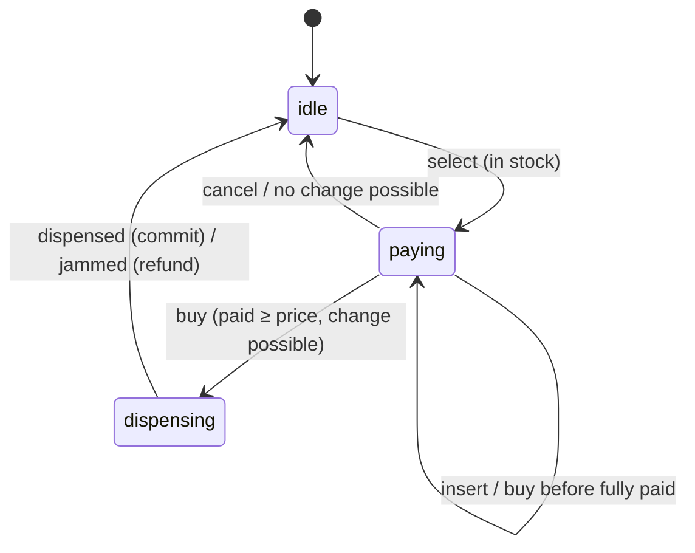

# Vending Machine, Functional Core

The classic low-level design interview question, solved without the State pattern: the whole machine is one pure function.

```ts
step(machine, event) → [machine, effects]
```

**▶ [Try it in the animated walkthrough](https://abo3ish.github.io/vending-machine/)**: buy something, jam the motor, run out of change, then scrub back through time and branch from any moment.

## The design



| File | Role |
|---|---|
| `src/machine.ts` | Types and `step()`: every (phase, event) pair, nothing else. No I/O, no clock, no mutation |
| `src/coins.ts` | Integer cents, coin counts, `makeChange()` |
| `tests/properties.test.ts` | fast-check: thousands of random event sequences against invariants |
| `docs/index.html` | The shell: renders the machine and replays events through the same core (`docs/vending.js` is built from `src/`) |

## Design decisions, compared with the usual OOP answer

The textbook solution is a `VendingMachine` class holding `selectedProduct`, `totalCoins` and `currentState`, plus a State pattern with Idle, Ready, Dispense and ReturnChange classes that call `machine.setState(new ...)`.

- **A transition table, not four classes.** A vending machine is a finite state machine: (state, event) → (state, actions). The State pattern spreads that table across classes that each hold a reference to the machine and mutate it.
- **`switch` is fine when the compiler checks it.** The OOP answer rejects `switch` on Open/Closed grounds. With discriminated unions and `noImplicitReturns`, dropping a case fails the build, which is stronger than OCP for a closed set of states.
- **Each phase carries its own data.** `idle` has none and `paying` has `slot` and `inserted`. "Idle with a product selected" cannot be written down.
- **Effects are data.** Returning change is something the machine does, not a place it waits in, so it is `{ tag: 'returnCoins', coins }` and not a `ReturnChangeState`. Tests read effects like any value, and the page animates them.
- **Commit on confirmation, so there is nothing to roll back.** Stock and the coin box change only when the hardware sends `dispensed`. On `jammed` the exact inserted coins go back and nothing was ever written.
- **Coins, not a total.** `totalCoins = 135` cannot tell you whether 35¢ of change is possible. The box keeps counts per denomination, and that is the only way "Exact change only" fits in the design.
- **Change by backtracking, not greedy.** 30¢ from {25, 10, 10, 10} defeats greedy, which takes the 25 and has no 5 left. `makeChange` backtracks and is checked against brute force.
- **Stock per slot.** The slot is what physically runs empty, and the same product can sit in two slots.
- **No locks in the core.** Events go through `step` one at a time. If the machine sits behind an API, serialising events per machine is the shell's job, and the core does not change.
- **Time travel for free.** The page stores no machine at all, only the start and a list of events, and calls `run(start, events)` on every render.

## Tests

Hand-written scenarios cover the obvious paths. The property tests generate random machines and up to 60 random events (coins while dispensing, sensor signals out of nowhere, slots that do not exist) and check, at every step:

- no coin is created or lost, per denomination: `box + inserted = box' + returned + escrow`
- the box grows by exactly the price of what was sold
- stock and coin counts never go negative
- nothing is dispensed unless it is in stock and fully paid
- the same events always produce the same history
- `makeChange` finds change exactly when brute force says it exists

To check they are not decorative: drop the line that pays change out of the box and three tests fail. Drop any `case` and `tsc` refuses to compile.

## Running it

Requires Node 23+.

```bash
npm install
npm test             # unit + property tests
npm run typecheck
npm run build:web    # rebuild docs/vending.js after changing src/
```

Open `docs/index.html` through any static server, for example `npx serve docs`.
